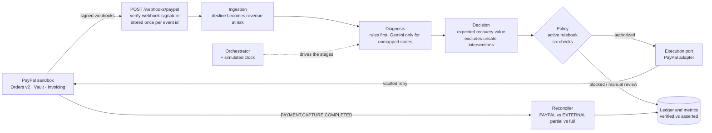
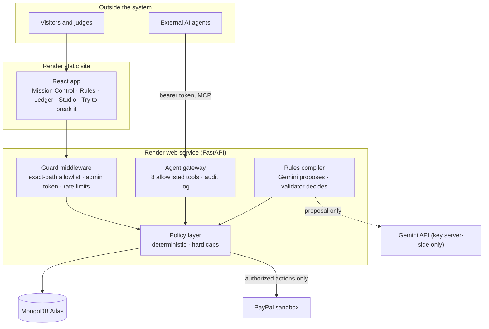
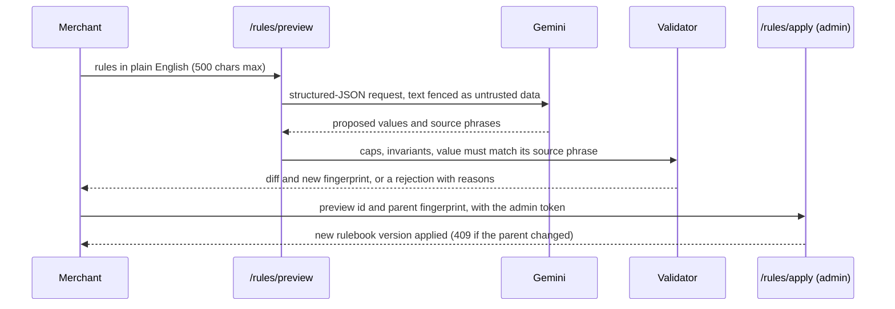

# Vasooli architecture

Diagrams render on GitHub. For the long-form design notes carried over from the first version, see [../ARCHITECTURE.md](../ARCHITECTURE.md).

## 1. The recovery pipeline

**Loop guard:** a `PAYMENT.CAPTURE.DECLINED` whose `custom_id` starts with `ev:` is a failed recovery attempt. It is attached to the original event and never creates new revenue at risk.

## 2. Trust boundaries

## 3. Plain-English rules: who decides what

The model never sees the policy engine and never applies anything. Values that break a cap are rejected with an explanation, never silently clamped.

## 4. Hard caps on merchant rules (USD profile)

| Parameter | Allowed range |
|---|---|
| Contacts per event | 1 to 5 |
| Cooldown between contacts | 6 to 168 hours |
| Auto-authorize below | $0 to $500 |
| Never auto at or above | $50 to $5,000 (must exceed the auto limit) |
| Minimum expected recovery value | $0 to $50 |
| Retries per event | 1 to 5 |
| Retry cooldown | 12 to 168 hours |

Immutable: the opt-out check, the list of policy checks, the reason precedence, the INR profile.

## 5. Verified versus asserted money

| | `gateway_verified` | `merchant_asserted` |
|---|---|---|
| Evidence | A signed PayPal webhook whose invoice or capture shows a PayPal-collected payment | A payment the merchant recorded outside PayPal |
| Counted as "Verified by PayPal webhook" | Yes | No |
| Mixed in one total | Never | Never |

Cumulative payments never double count: a partial then a full payment reports the invoice's cumulative paid amount, and out-of-order webhooks never move an event backwards.

## 6. The agent gateway

One shared tool core serves two adapters: a public REST page (`POST /agent/attempt`) and an MCP server (`/mcp`, bearer token).

| Tool | Type | Behavior |
|---|---|---|
| `list_at_risk_events`, `get_event_audit`, `get_active_rules` | read | Sanitized data only |
| `propose_recovery`, `propose_contact` | dry run | Real diagnosis, decision, and policy; nothing is written |
| `execute_recovery` | action | Needs an authorized verdict; sandbox only; refuses attack-range events; one per event per 10 minutes |
| `list_attack_scenarios`, `run_attack_scenario` | demo | Seven scripted attacks evaluated in memory; only audit rows are written |

Not offered: applying or reverting rules, reset, clock control, the orchestrator, raw PayPal calls. Unknown tools are refused and audited.

## 7. Collections

`events`, `diagnoses`, `decisions`, `policy_verdicts`, `executions`, `verifications`, `charge_attempts`, `customer_vault`, `orchestrator_runs`, `demo_runs`, `paypal_events`, `rulebook_versions`, `agent_audit`, plus rate-limit counters with TTL indexes. Stored documents and their read models are tested for symmetry, so a field written by the code can never be rejected on read.
