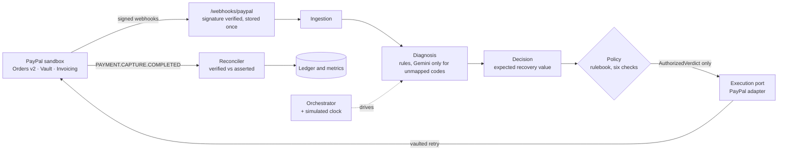

# Vasooli: a money-recovery agent that earns your trust

**Autonomy you can audit.** Vasooli recovers failed payments on PayPal, but it never acts on its own say-so: every action passes a deterministic policy layer, every recovery is confirmed by a signed PayPal webhook, and every decision can be re-derived later from a fingerprinted rulebook.

- **Live demo:** https://vasooli-paypal.onrender.com (sandbox, no login)
- **Video (under 3 min):** `<YOUTUBE URL>`
- **Devpost:** `<DEVPOST URL>`
- **What changed since the first version:** [WHAT_CHANGED.md](WHAT_CHANGED.md)

> Everything here runs against the **PayPal sandbox**. No real money moves.

## Who it is for and why it matters

**Who:** online merchants and subscription businesses that charge cards on file through PayPal, and small businesses that invoice through PayPal. The person who feels the problem is the owner or finance lead who wants recovery automated but must be able to answer "why did the agent do that, and can I stop it?"

**The problem:** when a renewal card declines, recovery usually means blind retries and nagging emails. Handing that job to an AI agent is tempting but risky: it touches money, and a wrong retry or an over-eager contact costs customers. Vasooli shows a recovery that is automatic, bounded by rules the merchant wrote, and proven by PayPal's own signed events. The demo recovers a declined payment end to end, with the matching transaction visible in the PayPal sandbox.

## How this maps to the judging criteria

| Criterion | Where to see it |
|---|---|
| **Technological implementation** | Real PayPal sandbox calls (Orders v2, vault, invoicing), signed-webhook verification, a reconciler that classifies PayPal-collected versus recorded payments, an orchestrator with a simulated clock, Gemini used for rule compilation under validation, an MCP server, and hundreds of automated checks including real-database tests. See [docs/architecture.md](docs/architecture.md). |
| **Design** | One coherent product: Mission Control, Rules, Ledger, Audit Trail, Studio, and Try to break it share one design system, honest labels, and a replay mode that works with no backend. |
| **Potential impact** | A specific problem (recovering declined payments) for a specific audience (PayPal merchants), demonstrated with a real recovered payment rather than a mock-up. |
| **Innovation** | The model proposes and deterministic code disposes; verified and asserted money never blend; every decision is re-derivable from a fingerprinted rulebook; outside agents are tested against scripted attacks. |
| **Presentation** | The video shows the whole flow working: rules, a real decline, retry, signed webhook, then the attack scene. |

## The idea in three acts

| Act | What you see | Where |
|---|---|---|
| **1. Say the rules** | A merchant types policy in plain English ("contact at most twice, wait 48 hours, ask me before anything over $100"). Gemini proposes structured values; deterministic code validates them against hard caps, shows a diff and a new fingerprint; only an admin can apply them. | `/rules` |
| **2. Watch it work** | A card on file is declined (a PayPal sandbox simulation). Vasooli reads the real decline code, diagnoses it, passes policy, retries the vaulted card through the PayPal API, and a **signed PayPal webhook** marks the money recovered. | `/live` |
| **3. Try to break it** | Outside AI agents reach Vasooli through a REST page and an MCP server. Seven scripted attacks (retry a do-not-retry decline, contact an opted-out customer, spend $1,500 unapproved, call "apply rules"...) are evaluated by the real policy layer and **blocked**, each one audited. | `/agent`, `/mcp` |

## What is real and what is simulated

| Real | Simulated or labelled |
|---|---|
| PayPal sandbox API calls (Orders v2, vault, invoicing), signed webhooks, the vaulted retry, the captured payment events | The initial decline is produced with PayPal's sandbox trigger (code 5120); sandbox money |
| Deterministic diagnosis, decision, policy, and verification code | The time-skip between decline and retry uses a **simulated clock**, labelled wherever it appears |
| Every figure on the dashboards (computed from the ledger) | "Replay" pages play back a **real saved run** with the waiting time compressed |
| Hard caps on rules, enforced in code | Attack scenarios run in dry-run on in-memory events and write nothing |

Sandbox webhooks take about a minute each, so a live run takes several minutes. No statistics in this project are invented.

## Try it in two minutes
1. **Mission Control** (`/live`): play the replay of a real run, or press **Run it live** (rate limited; sandbox only). The hero card shows "Verified by PayPal webhook" only when the ledger row is gateway-verified.
2. **Rules** (`/rules`): click an example chip. Note the parsed values with their source phrases, the hard-cap result, and the fingerprint. The injection example is refused.
3. **Try to break it** (`/agent`): click each scenario and watch the audit feed.
4. **Ledger** (`/ledger`): Verified versus Asserted badges; the "Needs approval" filter shows verdicts that route to a human.
5. **Studio** (`/studio`): an AG Studio dashboard over the sanitized ledger, with a read-only assistant that answers only from ledger queries.

## How it works



More diagrams and the trust boundaries: [docs/architecture.md](docs/architecture.md). Detailed design notes: [ARCHITECTURE.md](ARCHITECTURE.md).

Key design rules:
- **The model proposes, deterministic code disposes.** The LLM never writes customer messages and never authorizes anything. A structural `AuthorizedVerdict` type is the only way to reach execution.
- **Verified and asserted money are never blended.** A webhook-confirmed PayPal payment is `gateway_verified`; a payment recorded externally is `merchant_asserted`.
- **Re-derivable decisions.** Every verdict is stamped with a rulebook fingerprint (`rb1_...`); old rulebooks stay resolvable, so history can be re-checked exactly. The INR fingerprint has never changed.
- **A loop guard.** A declined recovery attempt is recorded against the original event and never creates new revenue at risk.

## PayPal APIs used
- **Orders v2:** card capture, `store_in_vault`, and server-side retries against a vaulted payment token (`vault_id`).
- **Vault / payment tokens:** `VAULT.PAYMENT-TOKEN.CREATED` links a card on file to a customer.
- **Webhooks:** `verify-webhook-signature` on every event; events stored once (unique event id); decline and completion events drive ingestion and verification.
- **Invoicing v2:** invoice creation and send, partial-payment settings, and recorded (external) payments, used to prove that PayPal-collected and externally recorded payments can be told apart.

## Where AI is used (Gemini)
- **Diagnosis fallback:** only for decline codes the rules do not map.
- **Plain-English rules compiler:** structured JSON output, temperature 0, the merchant's text treated as untrusted data, every value checked against hard caps and against its own source phrase; Gemini outages retry once and then fall back to a second model; example rules are cached.
- **Studio assistant (optional):** read-only analysis of the sanitized ledger; every figure must come from a ledger query; behind a kill switch and rate limits; no API key in the browser.
- **Promise-to-pay extraction:** free text to a validated commitment (live extraction is disabled on the public demo).

## Safety and security
- A guard allows only one public write route for runs (rate limited, sandbox only) and previews; every other write needs an admin token. Production **refuses to start** without the guard and an admin token.
- Public responses are sanitized: no vault ids, emails, card data, payer ids, or raw payloads.
- The MCP gateway exposes exactly **8 allowlisted tools** behind a bearer token. There is no tool for applying rules, resetting data, moving the clock, or making raw PayPal calls. Unknown tools are refused and audited.
- Atomic locks and rate limits are proven on a real MongoDB, not mocks.

## Tech stack
**Backend:** Python 3.12, FastAPI, Motor (MongoDB Atlas), Pydantic, `google-genai`, `httpx`, MCP SDK.
**Frontend:** React 19, Vite, TypeScript, Tailwind 4, TanStack Query, AG Grid Community 36.2.0, AG Studio 3.0.0, Vitest.
**Hosting:** Render (web service and static site), MongoDB Atlas.

## Sponsor tools
- **Render:** hosts the API and the static site.
- **AG Grid:** the Ledger and Audit Trail grids (AG Grid Community) and the Studio dashboard (AG Studio).
- **APIMatic:** the ContextMatic MCP server was used inside the coding agent to look up PayPal endpoints; see [docs/apimatic.md](docs/apimatic.md) for exactly how.

## Run it yourself

**Prerequisites:** Python 3.12, Node 22, a MongoDB Atlas (or local) database, a Gemini API key, and a PayPal sandbox app with Expanded Checkout, Vault, and Invoicing enabled.

```bash
# Backend
python3.12 -m venv .venv            # Windows: py -3.12 -m venv .venv
.venv/bin/pip install -r requirements.txt   # Windows: .\.venv\Scripts\python.exe -m pip install -r requirements.txt
cp .env.example .env                # fill in the values below; never commit .env
.venv/bin/python -m uvicorn app.main:app --port 8124

# Frontend (second terminal)
cd frontend && npm ci && npm run dev    # http://localhost:5173
```

Explore with sample data (no PayPal needed): seed a **separate** database and start the API against it.
```bash
MONGODB_DB_NAME=vasooli_regress .venv/bin/python scripts/s3_seed.py http://127.0.0.1:8124
MONGODB_DB_NAME=vasooli_regress .venv/bin/python scripts/s4_seed.py http://127.0.0.1:8124
```

Run the real PayPal flow: put the API behind a public HTTPS URL (a tunnel is fine), register `https://<your-url>/webhooks/paypal` as a webhook on your sandbox app (all events), set `PAYPAL_WEBHOOK_ID`, then run:
```bash
VASOOLI_ADMIN_TOKEN=<your admin token> .venv/bin/python scripts/p1_run_scenario.py --base https://<your-url> --customer demo-001 --amount 49
```

| Backend variable | Purpose |
|---|---|
| `MONGODB_URI`, `MONGODB_DB_NAME` | Database |
| `GEMINI_API_KEY` | Rules compiler, diagnosis fallback |
| `PAYPAL_ENV=sandbox`, `PAYPAL_CLIENT_ID`, `PAYPAL_CLIENT_SECRET`, `PAYPAL_WEBHOOK_ID` | PayPal sandbox |
| `DEFAULT_CURRENCY=USD` | Metrics currency |
| `PUBLIC_DEMO`, `ADMIN_TOKEN` | Write guard (required in production) |
| `CORS_ORIGINS` | Allowed frontend origin(s) |
| `PUBLIC_RUNS` | Enables the public "Run it live" route |
| `AGENT_TOKEN` | Bearer token for `/mcp` |
| `STUDIO_AI_ENABLED` | Studio assistant kill switch (off by default) |

Frontend: `VITE_API_BASE_URL`, `VITE_DEFAULT_CURRENCY`, `VITE_STUDIO_AI`, `VITE_AG_STUDIO_LICENSE_KEY`.

## Tests
Run against a **regression** database only (never your live one):
```bash
python scripts/p1_contract_checks.py                 # 190+ offline checks
python -m scripts.s10_validation_suite               # 41 adversarial and boundary checks
MONGODB_DB_NAME=vasooli_regress python scripts/p1_integration_reconciler.py   # real MongoDB checks
cd frontend && npm run test && npm run build         # frontend tests and build
```
Gates that call the original gateway's live API are held back to protect its quota. Counts change as the project grows.

## Limitations (honest ones)
- Sandbox only. The USD rulebook is the active profile; the original INR profile is frozen and kept for history.
- Free-tier hosting sleeps, so the first request can be slow. Sandbox webhooks take about a minute. Gemini occasionally returns "high demand" errors; example rules and cached results keep the main paths working.
- The learning loop and counter-offer features that were designed are not built.

## Project history
Vasooli began as an entry for another hackathon on a different payments gateway (Razorpay). That repository is frozen at the `razorpay-buildathon-submission` tag. This repository keeps the original pipeline and adds the PayPal integration, the orchestrator and simulated clock, the plain-English rules compiler, the agent gateway, and the frontend. Everything added after Oct 1, 2026 is listed in [WHAT_CHANGED.md](WHAT_CHANGED.md).

## License
MIT. See [LICENSE](LICENSE).